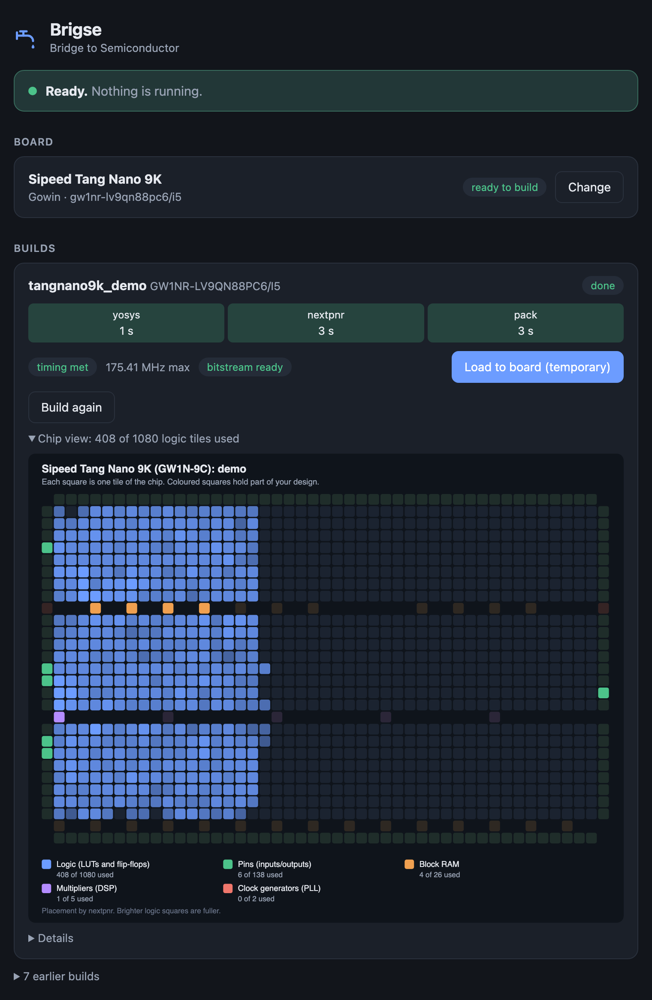
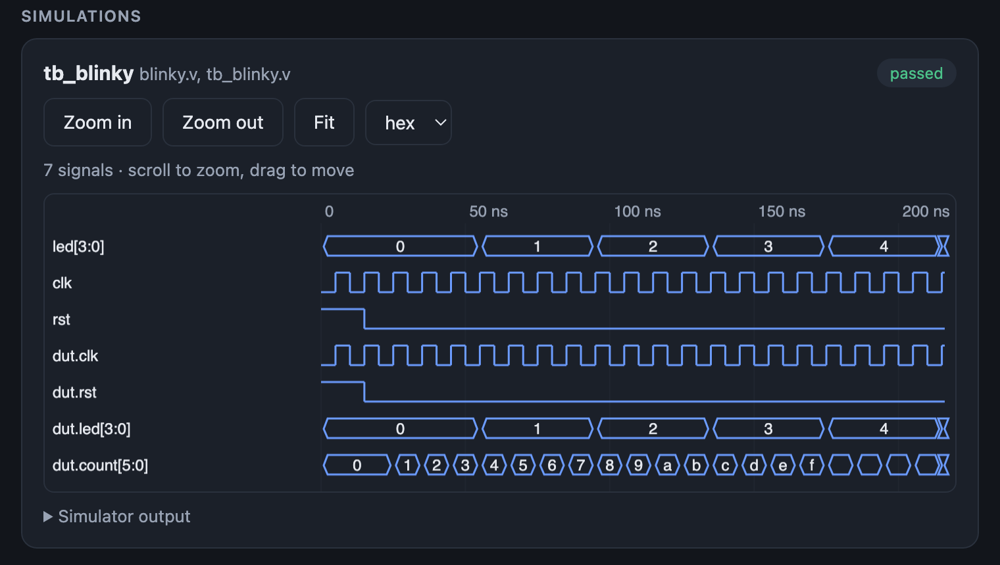

<p align="center"></p>

<h1 align="center">Brigse</h1>

<p align="center"><em>Bridge to Semiconductor.</em><br>
The name also sounds like the Greek word for a tap (βρύση), hence the logo.</p>

<p align="center">Made by <a href="https://github.com/Tslrs">Tslrs</a> together with
<a href="https://claude.com/claude-code">Claude</a> (Anthropic), working as a coding agent.
See <a href="#contributors">Contributors</a>.</p>

A modular [MCP](https://modelcontextprotocol.io) server that lets an AI agent build, inspect,
simulate and program FPGA designs through one set of tools. Each FPGA family is an add-on behind
a common interface, so the agent calls `build` the same way for every board.

> **Early stage (v0.1).** Brigse works on its author's machine, an Apple Silicon Mac on macOS 27, and
> has gone from Verilog to a running board on one board so far. It has not been tried on other
> machines or operating systems. Expect rough edges and breaking changes. Systematic testing is
> planned and listed below; until then, treat it as a working prototype.

Three add-ons are implemented: Xilinx ISE 14.7 for Spartan-3/3A/3E, and two for Gowin (the vendor's
Gowin EDA if you have it, and the open-source flow). When several add-ons cover a part, the usable
vendor tool is preferred; pass `backend` to `build` to choose.

Open-source add-ons are installed on request: the agent calls `request_install`, the plan (what,
from where, how big, licence) appears in the dashboard at `http://brigse.localhost:8765`, and only
the user can approve it there. Vendor tools and licences are never downloaded by the server.

### What has been checked so far

| Area | Checked | Not checked yet |
|---|---|---|
| Spartan-3A (ISE) | Builds of a small example and of the Next186 SoC; the SoC bitstream matched a reference build | Loading onto the board from macOS (not supported yet) |
| Gowin, vendor tool | Build, then a temporary load onto a Tang Nano 9K; LEDs seen blinking | Other Gowin boards and parts |
| Gowin, open-source | Install after approval, build, uninstall (on a test folder) | Its bitstream on a real board |
| Error explainer | 18 real failures from the three toolchains, plus 2 good builds that must stay quiet (`tests/test_diagnose.py`, no vendor tools needed) | Errors outside this list are reported unexplained |
| Chip view from a bitstream | Against a known placement: 408 of 408 logic tiles and 4 of 4 block RAM, no false ones; empty designs show nothing; on a real Gowin EDA build the block RAM count (19 of 26) equals the IDE's own report | Multipliers, input pins, other chips |
| Waveforms and chip view | Recording, text view, dashboard endpoint (`tests/test_waves.py`); chip view against a real placement (`tests/test_floorplan.py`); both also looked at in a browser | Large recordings (capped at 60 000 changes), other Gowin chips for the chip view (only the 9K was checked) |
| Dashboard and approvals | Board choice, approve/reject, buttons refused while something runs | Browsers other than the one used in development |
| Platforms | macOS 27 on Apple Silicon | Linux, Windows, Intel Macs |

The scripts in `tests/` drive the server over MCP the way an agent would; they need the real tools
installed and are run by hand.

### Planned

- Testing on Linux and on more boards
- Programming the Spartan-3A from macOS
- Add-ons for AMD 7-series and Cyclone V
- Parsed reports and clearer errors for larger designs

## How the idea came about

Brigse came out of [NanoLink86](https://github.com/Tslrs/NanoLink86), a project that runs FreeDOS on the
open-source Next186 x86 system-on-chip (by Nicolae Dumitrache) on two FPGA boards: a Sipeed Tang
Nano 9K (Gowin) and a Xilinx Spartan-3A Starter Kit. Two boards meant two vendor toolchains, and the
Spartan-3A was the problem: that chip can only be built with Xilinx ISE 14.7, a tool from 2013 with no
macOS version. Every build meant booting a 49 GB Ubuntu desktop VM, typing the same six commands and
reading thousand-line logs to find out whether timing had passed.

Two questions came out of that. Could the heavy part shrink, and could an AI agent do the routine
part? The first answer was a slimmed ISE (about 1.7 GB of the 17.8 GB install) in a small headless
VM. Along the way it turned out that ISE cannot run under user-mode x86 translators on Apple
Silicon at all, which is why the VM stays. The second answer was an MCP server, so that "build this
and tell me if timing passes" becomes one request instead of a ritual.

Having both boards in one project made it clear that each family should be a separate add-on: you
install only what your boards need, vendor tool or open-source flow, behind the same tools. The
local window and the approval step came from a simple rule: an agent may ask to download or delete
something, but a person decides.

The name is short for *Bridge to Semiconductor*, and it sounds like βρύση, the Greek word for a tap.

## Tools

| Tool | What it does |
|---|---|
| `list_backends` | Installed and planned add-ons, the parts each covers, and their state |
| `build` | Starts synthesis-to-bitstream as a background job, returns a `job_id` |
| `build_status` | Progress per step; when finished, fetches outputs and returns the report |
| `diagnose` | Explains a failed build in plain words (where, why, how to fix) and catches mistakes the tools let through |
| `chip_view` | Draws where a Gowin design sits on the chip, from its bitstream (Gowin EDA builds too), as SVG and a PNG for slides |
| `report` | Utilisation, timing (slack, and per clock its Fmax against the required frequency), failing constraints and bitstream from an output folder |
| `lint` | Checks Verilog in about a second with Verilator (syntax, undeclared names, widths, latches), each issue with file, line and source; run before a build that takes minutes. Falls back to Icarus Verilog's parser |
| `simulate` | Compiles and runs a Verilog testbench with Icarus Verilog and records every signal, with no change to the testbench |
| `utilization_by_module` | Which module of a design uses how much logic, flip-flops, block RAM and multipliers, from a quick separate synthesis that keeps the hierarchy (the build flattens it); biggest first. An estimate for the Gowin architecture |
| `cocotb_test` | Tests Verilog with a Python testbench ([cocotb](https://www.cocotb.org)) on Icarus Verilog: one row per test, with the assertion message of each failure. Needs `brigse install-cocotb` once |
| `waves` | Reads a recording as text for an agent: what changed and when, or one row per clock edge |
| `detect_boards` | USB probes and the JTAG chain (openFPGALoader) |
| `program` | Loads a bitstream; a dry run unless `confirm=true` |
| `backend_control` | Start/stop an add-on's runtime (the ISE VM) |
| `activity` | What is running right now and who started it (agent or user) |
| `list_boards`, `select_board` | Known boards and the one selected |
| `request_install`, `request_uninstall`, `install_status` | Ask the user to approve installing or removing an add-on |
| `dashboard_info` | Address of the local window |

## Error explainer

When a build fails, `build_status` and `diagnose` return the cause instead of thousands of log lines:
where it is, why it happens, how to fix it. The rules were written from output the real tools printed
when a design was broken on purpose; a message with no rule is passed on unexplained, never guessed at.

It also catches mistakes the tools let through. The open-source Gowin flow builds a design whose
signal name was mistyped (only a warning) and ignores a constraint for a name that is not in the
design; Gowin EDA silently puts a port with no pin constraint on a pin of its own. A failing timing
constraint is traced to its slowest path (ISE).

## Seeing what the tools did

- **Waveforms.** `simulate` records every signal. The dashboard draws them (zoom, drag, a cursor that
  shows each value, hex/binary/decimal); the `waves` tool gives an agent the same data as text, for
  example one row per rising clock edge.
- **Live log.** While a build runs, the Builds tab shows its log as it is written (Server-Sent Events,
  no polling): every step of the open-source Gowin flow and Gowin EDA, line by line. The ISE virtual machine
  keeps its logs inside the VM, so there the last lines of the current step are shown as they change.
- **Chip view.** For builds made with the open-source Gowin flow, the dashboard draws the chip as a grid
  of tiles and colours the ones that hold your design: logic, pins, block RAM, multipliers. It is drawn
  from the placement nextpnr wrote and the chip database that ships with the tools. Gowin EDA's own
  placement cannot be read outside its GUI, so for those builds (and any other Gowin bitstream) the
  `chip_view` tool reads the bitstream itself with `gowin_unpack` and counts the tiles that hold a
  configured LUT, a block RAM, a PLL or an output buffer. It never changes the file. Limits, also written on
  the picture: multipliers cannot be read, input pins cannot be told from unused ones, and only the
  GW1N-9C chip (Tang Nano 9K) has been checked. For a PNG that can go on a slide: `uv sync --extra png`.
  `examples/tangnano9k_demo` is a design that uses logic, block RAM and a multiplier, to show what a
  fuller chip looks like.

## The window

<p align="center"></p>
<p align="center"></p>


`brigse dashboard` opens `http://brigse.localhost:8765`, a page served on this machine only. It shows
what is running, the selected board, builds with their reports, and the add-ons. The user can pick
the board, approve or reject the agent's requests, repeat a build, load a build into the board's
SRAM (never flash), start or stop the ISE VM, and install or uninstall the open-source tools.
Only what Brigse downloaded can be uninstalled; vendor tools you installed are never touched.

The window answers only to this computer's own names and only to its own page: a request with a foreign
`Host` (DNS rebinding) or `Origin` (another site's page) is refused, every action needs a token that only the
loaded page has, the page cannot be put in a frame, and a decision on an agent's request cannot be changed
once made. `tests/test_dashboard_security.py` tries each of these attacks.

The agent and the user share the same rules: one build at a time per add-on and one use of the
programmer at a time. While anything runs, the page greys its buttons out and the server refuses
them, and the agent's tools get a clear "already running" answer.

## Install

```bash
brew install uv icarus-verilog openfpgaloader verilator   # verilator is optional: it makes `lint` stronger
git clone https://github.com/Tslrs/Brigse.git ~/brigse && cd ~/brigse && uv sync
```

Connect it to your AI app with one command. It adds only its own entry, keeps your other servers,
saves the old file as `.bak`, and then starts Brigse the way the app will, to check that it answers:

```bash
uv run brigse install-agent antigravity     # or: claude-desktop, claude-code, --all
uv run brigse install-agent --all --dry-run # show what would change, write nothing
```

Then restart the app. Builds can be long (an ISE build takes about 25-30 minutes), so every
`build` and `build_status` answer carries a `next` field that tells the agent what to do: ask
again in 50 seconds, or, when it is finished, read the report and the diagnosis before saying it worked.

### In the terminal

No browser needed. These work in any terminal (Ghostty, iTerm, over ssh):

```bash
uv run brigse status            # board, builds with time and timing, simulations, add-ons, pending requests
uv run brigse status --watch    # the same, refreshing every 3 seconds
uv run brigse approvals         # answer the agent's requests: approve, reject or skip
uv run brigse dashboard         # open the full window in the browser
uv run brigse install-cocotb    # once, to use Python testbenches: a small separate environment, about 40 MB
```

`approvals` only works in a real terminal and needs the whole word typed. When it is run from
a script or an agent's pipe, it refuses and leaves the request pending.

## Add-ons

| Add-on | Parts | Toolchain | State |
|---|---|---|---|
| `ise_spartan3` | `xc3s*` | Xilinx ISE 14.7 in a headless x86 VM | implemented |
| `gowin_eda` | `gw1n*`, `gw2a*`, `gw5a*` | your own Gowin EDA install (`gw_sh`), full device support | implemented |
| `gowin_oss` | `gw1n*`, `gw2a*`, `gw5a*` | yosys + nextpnr-himbaechel + apicula (OSS CAD Suite) | implemented |
| `xilinx7_oss` | `xc7*` | yosys + nextpnr-xilinx | planned |
| `cyclone5_oss` | `5c*` | yosys + nextpnr-mistral | planned |

An add-on is one module in `src/brigse/backends/` that subclasses `Backend`
(`status`, `build_start`, `build_status`, `report`, `control`) and is listed in `registry.py`.

### Spartan-3A add-on (ISE 14.7)

ISE has no macOS build, and on Apple Silicon it does not run under user-mode x86 translators
(box64, qemu-user and FEX-Emu were all tried). It therefore runs in a small headless x86-64
Debian VM under Lima/QEMU: about 3 GB instead of a full desktop VM.

You need your own licensed ISE 14.7 install (WebPACK is free). **ISE binaries and licence files
are not part of this repository and must not be committed.** Only the command-line tools and the
Spartan-3 device data are needed, about 1.7 GB of the 17.8 GB install:

- `ISE_DS/ISE/{bin,lib}/lin64`, `ISE_DS/common/{bin,lib}/lin64`
- `ISE_DS/ISE/{data,xilinx,xilinxun,fpga,fpgacore,cse,msg,verilog,vhdl,xcf,xcfp}` (without `data/cse/cseflash`)
- `ISE_DS/ISE/{spartan3,spartan3a,spartan3e,spartan3adsp,virtex,virtex2,virtex2p}`

Create the VM and unpack that tree to `/opt/Xilinx/14.7/ISE_DS`, with the licence in `~/.Xilinx/`:

```bash
brew install lima lima-additional-guestagents qemu
LIMA_HOME="$PWD/vm" limactl start --name=ise --tty=false --arch=x86_64 --vm-type=qemu --cpus=4 --memory=4 --disk=8 --containerd=none template:debian-12
```

`build` copies the project into the VM, runs `xst`, `ngdbuild`, `map`, `par`, `trce` and `bitgen`,
and copies the results to `<project>/build_out/<job_id>/`. If `<top>.xst` exists the project's
own synthesis script is used; otherwise a `.prj`/`.xst` pair is generated from the sources.

Everything runs under full emulation, so it is slow: the Next186 SoC (55% of an XC3S700A) takes
about 27 minutes.

Known limits:

- Programming a Spartan-3A from macOS is untested. openFPGALoader does not list the XC3S700A or
  the Xilinx Platform Cable USB, so `program` refuses that part instead of guessing.
- One VM, one build at a time is the tested case.

## Where things live

Everything Brigse needs can sit in one folder, next to the code:

```text
Brigse/
├── src/ tests/ examples/ ...   the code (this repository)
├── ise-lite/                   your own slimmed ISE archives (never committed)
├── data/                       state and the open-source tools Brigse downloaded (never committed)
└── vm/                         Lima's home, with the small ISE virtual machine (never committed)
```

If `data/` exists next to the code it is used; otherwise `~/.brigse`. Set `BRIGSE_HOME` to choose another
place. The same goes for `vm/` and `BRIGSE_VM_HOME` (otherwise Lima's default, `~/.lima`). To run `limactl`
by hand against that VM: `export LIMA_HOME=<this folder>/vm`.

## Test

The checks that need no vendor tools run with `uv sync --group dev && uv run pytest` (needs `iverilog` for the
waveform test; the MCP protocol is tested against a fake add-on, `tests/mock_server.py`) and on every push through GitHub Actions (Linux and macOS). The rest drive the real tools:

```bash
uv run python tests/smoke_client.py          # protocol, simulate, report
uv run python tests/smoke_client.py --build  # also builds examples/blinky in the ISE VM
```

## Related work

[fpgaZeroMCP](https://glama.ai/mcp/servers/lcapossio/fpgaZeroMCP) (open-source flow),
[fpga-mcp by wmm246](https://glama.ai/mcp/servers/wmm246/fpga-mcp) (Vivado/Quartus/Anlogic) and
several Vivado-only servers cover current devices. This project's focus is the add-on structure
and legacy ISE-only parts.

## Contributors

| Who | Part |
|---|---|
| [Tslrs](https://github.com/Tslrs) | Idea and direction, design decisions, the boards and licences, testing on real hardware |
| [Claude](https://claude.com/claude-code) (Anthropic) | Implementation, the dashboard, tests and this documentation, written as a coding agent in Claude Code under Tslrs's direction |

Every commit records both, with Claude as co-author.

## Licence

Brigse is released under the [MIT licence](LICENSE). It covers only the code in this repository.
The FPGA vendor tools that the add-ons drive (Xilinx ISE, Gowin EDA) have their own licences and
are not distributed here.
